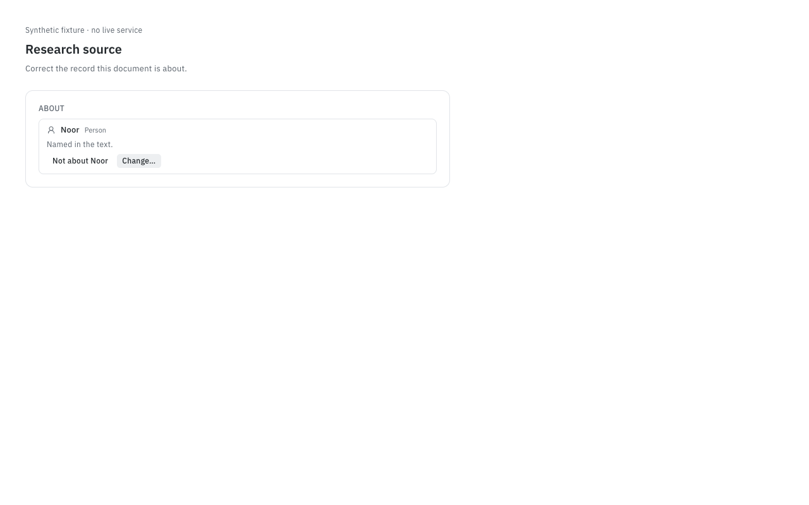
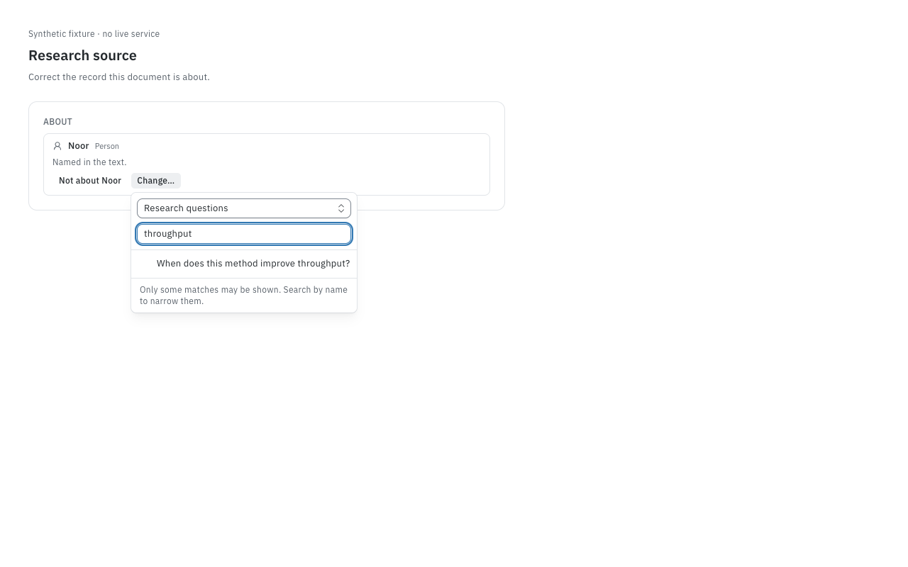
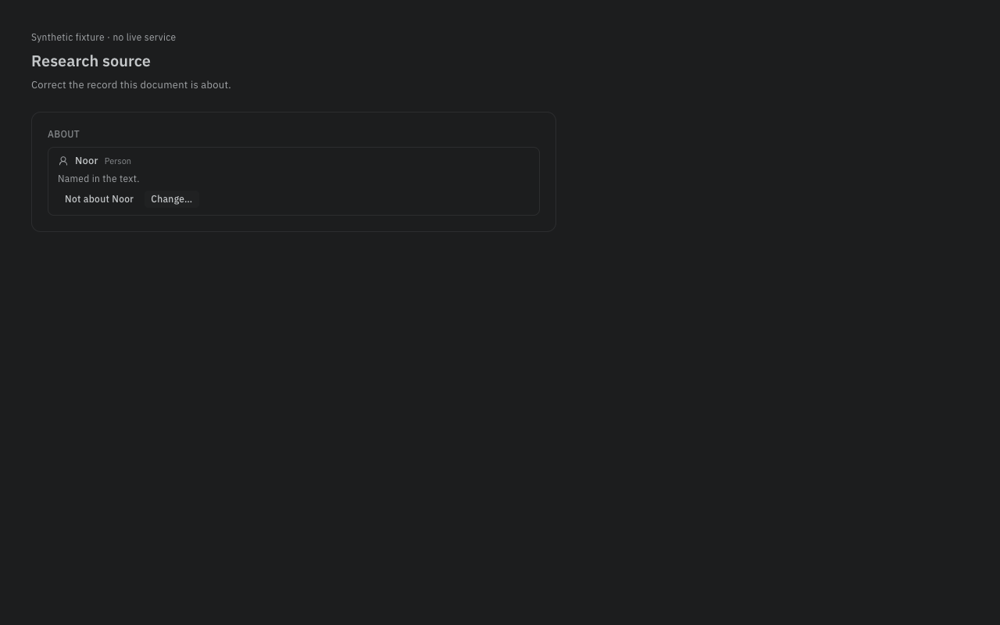
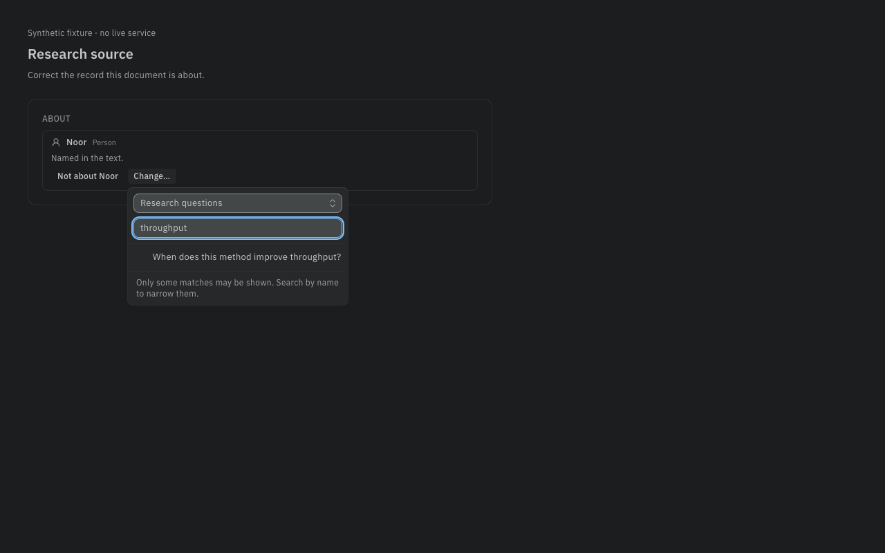

# About record link browser evidence

The isolated browser scenario passes in Chromium 156.0.8078.4 at **1280 × 800**, using the `github-sharp` palette in both light and dark themes. All records, filing receipts, and responses are synthetic. The screenshots display that scope on the page.

Run from the repository root with `node scripts/e2e/index-record-links.mjs`. This uses the installed `playwright-core` and full Chromium, following the existing e2e harness pattern. Set `E2E_CHROMIUM` to an available Chromium executable if needed.

The prior About component comes from pinned commit `f7c31043feaef8e0c3f321924c998dd7258a120d`; `E2E_BASELINE_REF` can explicitly override it. The runner generates that baseline module temporarily and removes it, its Vite cache, browser, and server after the run. It does not change the app's Vite configuration or dependencies. The implementation commit, tested component SHA-256 hashes, browser version, requests, assertions, and final accessibility outlines are recorded in [browser-report.json](browser-report.json).

## Before and after

The baseline can search only the linked record's type. The changed picker exposes the declared record types, including the custom `ResearchQuestion` type, and searches that type's `question` title field.

| Theme | Baseline picker                                                  | Changed picker with research result                                                    |
| ----- | ---------------------------------------------------------------- | -------------------------------------------------------------------------------------- |
| Light |  |  |
| Dark  |    |    |

| Supporting state          | Light                                          | Dark                                          |
| ------------------------- | ---------------------------------------------- | --------------------------------------------- |
| Record type menu          | [Open menu](light-record-types.png)            | [Open menu](dark-record-types.png)            |
| Saved correction and Undo | [Corrected About section](light-corrected.png) | [Corrected About section](dark-corrected.png) |

The eight captures retain the comparison, type menu, result choice, and corrected state. The final restored state is asserted and recorded in the report rather than repeated in another screenshot.

## Interaction evidence

The real `RecordLinks`, `RecordLinkPicker`, coss Select/Combobox, query hooks, and API client run in a minimal memory-router page.

1. The baseline opens with a person search and no record-type selector.
2. Focused Change opens with Enter. The changed trigger is found by its accessible name, `Change linked record`.
3. Record type → Research questions keeps the About picker open and changes the search input to `Find a research question`.
4. Searching `throughput` finds `When does this method improve throughput?`. Searches use only the selected type, with each research query request limited to 20 records.
5. Selecting that result calls the existing `/api/documents/v2/record-filings/r1/corrections` route with `recordItemId: record:ResearchQuestion/question:throughput`. The refreshed About section displays the question and `Linked here by a person.`
6. Undo calls `/api/documents/v2/record-filing-corrections/c1/undo` and restores the original Noor link. The target record itself remains at version 1 with its question unchanged.

Both themes pass these checks. The dark run additionally selects the type with End then Enter, verifies Tab moves from the type selector to the record-search input, and selects the result with ArrowDown then Enter. Opening the type menu and activating Undo use pointer clicks; this is a concrete mixed keyboard/pointer check, not a full keyboard-only or screen-reader audit. There are 15 recorded assertions and no page errors or failed HTTP requests in the successful run.

## Fixture boundary

All application fetches are answered in memory using the existing CRM fixture plus synthetic filing/correction/Undo responses. The browser independently blocks requests outside the runner's loopback origin. Record-page navigation and the unrelated OpenUI library publisher are replaced by throwing stubs and are not invoked. The fixture does not perform record writes, sign in, or contact a deployed backend.

This evidence demonstrates browser interaction, focus movement, rendering, client request construction, and the UI's receipt-driven refresh and Undo behavior. It does **not** establish that the pending backend implementation accepts these requests or persists corrections. Live integration remains a separate check after the backend is available. This fixture also does not cover the full application shell, mobile layouts, other browsers, or other palettes.
